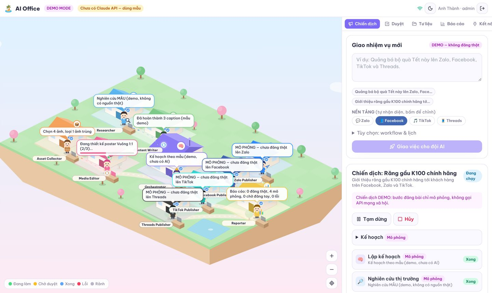

# 🏝️ AI Office — Hệ thống Multi-AI Agent với văn phòng ảo isometric

Một **Orchestrator** cùng **9 AI Agent** tự lập kế hoạch, nghiên cứu, thu thập tư liệu, chỉnh ảnh/dựng video, viết bài, chờ anh **duyệt**, rồi đăng lên **Zalo OA · Facebook Page · TikTok · Threads** và xuất **báo cáo PDF/Excel**. Toàn bộ tiến trình hiện trực tiếp trên một văn phòng mini dạng isometric.



---

## 1. Chạy thử trong 2 phút (Demo Mode)

Yêu cầu: **Node.js ≥ 22.13**, `ffmpeg` (để dựng video, tùy chọn).

```bash
cd ai-office
npm install
npm run build        # build giao diện
npm start            # http://127.0.0.1:8787
```

Mở trình duyệt → tạo tài khoản quản trị → gõ nhiệm vụ, ví dụ:

> Quảng bá bộ quà Tết này lên Zalo, Facebook, TikTok và Threads.

Không cần API key nào. Ở **Demo Mode**:
- Lập kế hoạch, nghiên cứu, viết bài dùng **mẫu có gắn nhãn "Mô phỏng"** (không bịa nguồn).
- Thu thập, chỉnh ảnh (poster 1:1, 4:5, 9:16, 1.91:1) và dựng video 9:16 là **xử lý thật** trên ảnh sản phẩm trong thư viện (ảnh `.png` ở gốc repo được nạp sẵn lần đầu).
- Bước đăng bài **chỉ mô phỏng**, ghi trạng thái `MÔ PHỎNG`, không có link, không có số liệu.

Chế độ phát triển (hot reload cả 2 phía): `npm run dev` → giao diện ở http://localhost:5173.

Chạy test: `npm test` (15 test: planner, DAG workflow, toàn bộ quy trình demo, phân quyền, ẩn secret, retry/backoff, lỗi fatal + chạy lại, hủy, production thiếu kết nối → đăng thủ công).

---

## 2. Kiến trúc

```
                 ┌───────────────────────── Web (React + TS + Tailwind) ─────────────────────────┐
                 │  Văn phòng isometric (SVG 2.5D)  ·  Chiến dịch  ·  Duyệt  ·  Tư liệu  ·  Báo cáo │
                 │  Kết nối  ·  Workflow  ·  Nhật ký  ·  Người dùng        ◄── SSE realtime ──┐    │
                 └──────────────────────────────┬──────────────────────────────────────────────┘    │
                                    REST /api   │                                                   │
┌───────────────────────────────── Server (Node + Fastify + TypeScript) ──────────────────────────┐ │
│ Auth (scrypt, cookie session, admin/editor/viewer)    Vault AES-256-GCM cho API key/token        │ │
│                                                                                                   │ │
│  Orchestrator Engine ── task queue bền (SQLite) ── worker pool (song song, 1 việc/agent)          │ │
│    • DAG phụ thuộc • retry + backoff • timeout • agent dự phòng • cổng phê duyệt                 │─┘
│    • pause/resume/cancel • hẹn giờ bắt đầu & hẹn giờ đăng • khôi phục sau khi khởi động lại       │
│                                                                                                   │
│  Agents: Planner · Researcher · Collector · Editor · Writer · Zalo · Facebook · TikTok · Threads │
│          · Reporter (số liệu + báo cáo)                                                           │
│  LLM: Claude (claude-opus-5-5, web search, MCP connector) — interface thay được model khác        │
│  Media: sharp (poster, dHash chống trùng) · ffmpeg (video 9:16) · URL ký số cho nền tảng          │
│  Integrations: Zalo OA · Meta Graph · TikTok Content Posting · Threads · Drive · Tavily · Pexels  │
│  Reports: Excel (exceljs) · PDF (pdfkit + font DejaVu tiếng Việt)                                 │
└───────────────────────────────────────────────────────────────────────────────────────────────────┘
```

### Thư mục

```
ai-office/
├── server/src
│   ├── app.ts                 # toàn bộ REST API + SSE + phục vụ web build
│   ├── orchestrator/          # engine.ts (queue/worker), planner.ts, workflows.ts
│   ├── agents/                # 9 agent + orchestrator, mỗi agent 1 file
│   ├── integrations/          # adapter từng nền tảng, OAuth, MCP, token refresh
│   ├── llm/                   # interface LLM + Claude
│   ├── media/                 # lưu trữ, poster, video, URL công khai ký số
│   ├── reports/               # Excel / PDF / tổng quan
│   ├── auth/  core/  db/      # phân quyền, vault, event bus, SQLite
└── server/test/               # vitest
├── web/src
│   ├── components/office/     # OfficeScene, Building, Avatar, AgentStrip, iso.ts
│   ├── components/panels/     # các bảng điều khiển
│   └── lib/                   # api client, store (zustand + SSE)
└── docs/
```

### Quy trình mặc định (`wf_full`)

| # | Bước | Agent | Input → Output | Lỗi |
|---|------|-------|----------------|-----|
| 1 | Lập kế hoạch | Orchestrator | mục tiêu tiếng Việt → sản phẩm, đối tượng, thông điệp, từ khóa | retry 2 lần |
| 2 | Nghiên cứu ∥ 3. Thu thập | Researcher ∥ Collector | kế hoạch → insight/ý tưởng/nguồn ∥ ảnh được phép, loại trùng, ghi giấy phép | retry 3, backoff |
| 4 | Chỉnh sửa ∥ 5. Viết bài | Editor ∥ Writer | ảnh → poster theo tỉ lệ + video ∥ nghiên cứu → 3 phương án/nền tảng | timeout 5 phút |
| 6 | **Người dùng duyệt** | Orchestrator | chọn phương án + ảnh, sửa chữ, hoặc gửi góp ý viết lại | chờ vô hạn |
| 7 | Đăng Zalo ∥ FB ∥ TikTok ∥ Threads | 4 Publisher | nội dung đã duyệt → bài đăng thật / nháp / thủ công / mô phỏng | lỗi 1 nền tảng không chặn nền tảng khác |
| 8 | Thu số liệu → 9. Báo cáo | Reporter | bài đăng thật → reactions/views… → PDF + Excel | chạy cả khi bước trước lỗi |

Mỗi bước có trạng thái, tiến độ %, số lần chạy, lỗi, output JSON, nhật ký, nút **Chạy lại**. Workflow có thể nhân bản, bật/tắt bước, đổi số lần thử, đặt **agent dự phòng**, và lưu để tái sử dụng (tab Workflow). Ngoài ra có sẵn `wf_quick` (bỏ nghiên cứu) và `wf_content` (chỉ sản xuất, không đăng).

### Nguyên tắc trung thực của kết quả

Mọi task/bài đăng mang nhãn nguồn gốc: **Thật** · **AI** · **Mô phỏng** · **Thủ công** · **Không có dữ liệu**. Bài mô phỏng không bao giờ có link hay số liệu; số liệu tương tác chỉ lấy từ API của bài đăng thật.

---

## 3. Chuyển sang Production

1. Tạo file `.env` từ `.env.example`, đặt **`APP_SECRET`** (bắt buộc) và **`PUBLIC_BASE_URL`** (URL https công khai — cần cho OAuth, ảnh Threads, ảnh bìa Zalo OA).
2. Tab **Kết nối**: nhập Claude API key → "Kiểm tra". Nhập thông tin ứng dụng từng nền tảng rồi "Kết nối bằng OAuth" (hoặc dán token trực tiếp).
3. Chuyển **Chế độ vận hành → Production** (chỉ admin).
4. Nền tảng nào chưa kết nối sẽ tự chuyển sang **đăng thủ công**: hệ thống chuẩn bị caption + media để tải về, anh đăng tay rồi dán link → báo cáo ghi "Đã đăng tay".

Redirect URI OAuth cần đăng ký với nền tảng: `{PUBLIC_BASE_URL}/api/oauth/{facebook|threads|tiktok|zalo|gdrive}/callback`.

### Khả năng tích hợp từng nền tảng

| Nền tảng | Làm được tự động | Không làm được / thay thế | Quyền cần |
|---|---|---|---|
| **Zalo OA** | Tạo & xuất bản bài viết OA (article) có ảnh bìa | **Không có API đọc/đăng nhóm Zalo cá nhân** → tải tệp từ nhóm về rồi upload (tab Tư liệu); đăng nhóm bằng gói thủ công. Broadcast/ZNS cần gói trả phí — chưa tích hợp | App Zalo for Developers liên kết OA đã xác thực |
| **Facebook Page** | Đăng ảnh/video/bài chữ lên Page, đọc reactions/comments/shares | Không đăng Group/trang cá nhân | `pages_show_list`, `pages_read_engagement`, `pages_manage_posts` |
| **TikTok** | Upload video: **Inbox** (vào hộp nháp, mặc định) hoặc **Direct Post** | App chưa audit chỉ đăng được `SELF_ONLY`; MVP chưa làm photo mode | `video.upload`, `video.publish`, `user.info.basic` |
| **Threads** | Bài chữ / bài ảnh (container → publish), insights | Ảnh cần URL công khai; thiếu `PUBLIC_BASE_URL` → đăng bài chữ | `threads_basic`, `threads_content_publish`, `threads_manage_insights` |
| **Google Drive** | Lấy ảnh trong 1 thư mục (readonly) | — | `drive.readonly` |
| **Claude** | Kế hoạch, nghiên cứu có web search + nguồn, viết bài, MCP connector | — | API key |
| **Tavily / Pexels** | Tìm web / ảnh stock có giấy phép | — | API key |

> ⚠️ **Lưu ý xác minh:** các adapter được viết theo tài liệu chính thức của từng nền tảng nhưng **chưa được gọi thử với tài khoản thật** trong quá trình xây dựng (chưa có credential). Lần đầu kết nối, hãy dùng nút **Kiểm tra** và đăng thử 1 bài ở chế độ riêng tư/nháp. Phiên bản Graph API cấu hình qua `FB_GRAPH_VERSION`.

### MCP Server

Tab Kết nối → MCP Servers: thêm server MCP từ xa (HTTPS + Bearer token tùy chọn). Researcher sẽ cho Claude dùng các công cụ đó qua MCP connector; nút "Kiểm tra" liệt kê tool bằng MCP SDK.

---

## 4. Phân quyền & bảo mật

- **admin**: mọi quyền, cấu hình kết nối, đổi chế độ, quản lý người dùng. **editor**: tạo/điều khiển chiến dịch, duyệt, upload. **viewer**: chỉ xem.
- Mật khẩu băm scrypt; phiên đăng nhập bằng cookie httpOnly SameSite=Lax (đặt `COOKIE_SECURE=true` sau HTTPS).
- API key/token mã hóa AES-256-GCM trong DB, **không bao giờ trả về trình duyệt** (chỉ hiện dạng `abcd••••wxyz`). Không hardcode key trong code.
- Media chỉ truy cập khi đăng nhập; URL công khai cho nền tảng được **ký HMAC, hết hạn sau 7 ngày**.
- Upload bắt buộc xác nhận quyền sử dụng; mỗi tư liệu lưu nguồn + giấy phép.

## 5. Triển khai lên server

```bash
# trên VPS (Ubuntu): cài Node 22 + ffmpeg, rồi
git clone … && cd ai-office && npm ci && npm run build
cp .env.example .env   # đặt APP_SECRET, PUBLIC_BASE_URL, HOST=127.0.0.1, COOKIE_SECURE=true
npm start              # hoặc dùng pm2/systemd
```
Đặt Nginx/Caddy reverse proxy HTTPS → `127.0.0.1:8787` (tắt buffering cho `/api/events` để SSE chạy realtime: `proxy_buffering off;`). Sao lưu thư mục `server/data/` (SQLite + media + khóa).

Mở rộng: engine dùng hàng đợi trong SQLite + event bus nội bộ, phù hợp 1 server. Khi cần nhiều worker: thay `orchestrator/engine.ts` tick loop bằng BullMQ/Redis và `core/bus.ts` bằng Redis pub/sub — schema task giữ nguyên.

## 6. Phần chưa có / bước tiếp theo

- Chưa kiểm thử với tài khoản Zalo/Meta/TikTok thật (xem lưu ý ở trên).
- TikTok photo mode, Facebook album nhiều ảnh, Zalo broadcast/ZNS.
- Thu số liệu TikTok (cần scope `video.list`) và lịch thu số liệu định kỳ sau khi đăng.
- Ảnh tham chiếu giao diện chưa được tải lên trong phiên này — giao diện được thiết kế theo mô tả (đảo nổi isometric, pastel). Gửi ảnh để tinh chỉnh tiếp.
